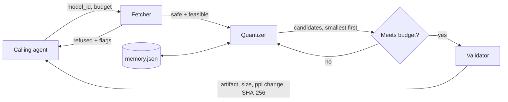

# Quantize-as-a-Tool

**Model compression that AI agents can call, with an accuracy budget and proof.**

An agent sends a Hugging Face model ID and an accuracy budget. It gets back the smallest 4-bit or 8-bit version of that model that stays within the budget, together with measured size, measured quality change and a SHA-256 of the artifact. It is exposed over HTTP and as an MCP tool.

> **Category:** Software built for agents. Compression tools are built for ML engineers, with many formats, silent quality loss and no verification. This project gives agents one safe, bounded, verifiable call instead.

---

## Why this exists

An agent that needs a smaller model (for an edge device, lower cost or faster inference) has no safe way to get one today. Calling a quantizer blindly can ship a degraded model without anyone noticing, and the right format differs from model to model.

This service makes the trade-off explicit:

- The caller states how much quality it can lose (`accuracy_budget_pct`).
- The service **measures** each candidate format against the fp16 baseline instead of assuming.
- The caller receives the smallest format that passes, or a clear refusal.

## Measured results

Tesla T4, WikiText-2 perplexity (40k tokens, 512-token windows), 10% budget unless noted.

| Model | Params | Format chosen | Size (vs fp16) | Perplexity change |
|---|---|---|---|---|
| Qwen2.5-0.5B | 0.5B | int8 | 0.63 GB (vs 0.99 GB) | +0.89% |
| TinyLlama-1.1B-Chat | 1.1B | NF4 4-bit | 0.75 GB (vs 2.2 GB) | +5.42% |
| Qwen2.5-1.5B | 1.5B | NF4 4-bit | 1.12 GB (vs ~3.1 GB) | +8.66% |
| Phi-2 | 2.7B | NF4 4-bit | 1.78 GB (vs ~5.6 GB) | +5.94% |

**Key finding:** the right format depends on the model. On Qwen2.5-0.5B, 4-bit costs +12.9% perplexity and fails a 10% budget, so the service falls back to int8. With a 15% budget the same model accepts 4-bit at about 0.47 GB. On the larger models, 4-bit passes on the first try. Within the Qwen family, the 4-bit penalty shrinks as the model grows (+12.9% at 0.5B, +8.7% at 1.5B). A fixed recipe would either waste space or ship a worse model.

Raw reports are in [`results/`](results/), and every measured configuration is cached in [`memory.json`](memory.json).

## How it works



1. **Fetcher** reads metadata only, with no weight download and no code execution. It refuses gated, pickle-only, remote-code (`trust_remote_code`), already-quantized and oversized (>3B parameters) models, and returns the reasons as machine-readable flags.
2. **Quantizer** walks a ladder of formats (NF4 + double quantization, NF4, int8), smallest first. It stops at the first one whose perplexity increase over the fp16 baseline is within the budget.
3. **Validator** records the perplexity change, the size and a SHA-256 of the saved weights so the result can be checked later.
4. **Memory** stores every measured configuration per model. Known failures are skipped and known passes are not re-measured, so repeat requests return in seconds.

## Agent-facing features

| Feature | Behavior |
|---|---|
| Explicit budget | `accuracy_budget_pct` is an input, not a hidden default |
| Clean refusals | Bad input returns `200` with `status: REFUSED` and `flags`, never a crash |
| Auth | `/quantize` requires an `X-API-Key` header |
| GPU lock | Concurrent requests queue instead of fighting over VRAM |
| Size cap | Models above 3B parameters are refused before any download |
| Async jobs | `POST /jobs` returns a job ID instantly and `GET /jobs/{id}` reports progress, so long runs never hit a tunnel timeout |
| Per-request output | Each request writes to its own artifact folder |
| Verification | Result includes size, perplexity change and artifact SHA-256 |

## Quick start (Google Colab, T4 GPU)

Set the runtime to **T4 GPU**, then:

```python
!git clone https://github.com/SUFIYAN2004/quantize-as-a-tool
%cd quantize-as-a-tool
!pip install -q -U -r requirements.txt
%run quantize_service.py
server, key, url = start_service()
print(url)  # the API key is saved to /content/api_key.txt
```

`start_service()` starts the API on port 8000 and opens a temporary public URL through a Cloudflare quick tunnel.

## API

### `POST /quantize`

Header: `X-API-Key: <key>`

```json
{
  "model_id": "TinyLlama/TinyLlama-1.1B-Chat-v1.0",
  "accuracy_budget_pct": 10.0,
  "bits": "auto"
}
```

`bits` is `"auto"`, `"4"` or `"8"`.

```bash
curl -X POST "$URL/quantize" \
  -H "X-API-Key: $KEY" -H "Content-Type: application/json" \
  -d '{"model_id": "TinyLlama/TinyLlama-1.1B-Chat-v1.0", "accuracy_budget_pct": 10}'
```

**Success**

```json
{
  "status": "SUCCESS",
  "model_id": "TinyLlama/TinyLlama-1.1B-Chat-v1.0",
  "winner": "nf4+double_quant",
  "winner_stats": { "ppl_increase_pct": 5.42, "size_gb": 0.747 },
  "fp16_size_gb": 2.2,
  "attempts": [
    { "config": "nf4+double_quant", "ppl_increase_pct": 5.42, "size_gb": 0.747,
      "source": "memory", "verdict": "PASS" }
  ],
  "artifact_sha256": "…"
}
```

**Refusal**

```json
{ "status": "REFUSED", "flags": ["TOO_LARGE: 7615.6M params > 3000M limit"] }
```

Possible flags: `GATED`, `NOT_FOUND`, `TOO_LARGE`, `REMOTE_CODE`, `PICKLE_ONLY`, `ALREADY_QUANTIZED`, `FETCH_ERROR`.

Other statuses: `NO_CONFIG_MET_BUDGET` (no format stayed within the budget) and `UNAUTHORIZED` (HTTP 401, missing or wrong key).

### `POST /jobs` and `GET /jobs/{job_id}` (recommended for new models)

`POST /jobs` takes the same body as `/quantize` and returns immediately:

```json
{ "job_id": "c1cd88e92203", "status": "QUEUED" }
```

Poll `GET /jobs/{job_id}` (same `X-API-Key` header) every 10 to 30 seconds. `status` moves through `QUEUED`, `RUNNING`, then `DONE` or `FAILED`. When `DONE`, the response includes `result`, which has the same shape as the `/quantize` response (a `SUCCESS` result or a `REFUSED` one with flags). An unknown job ID returns `404`.

### `GET /health`

Returns `{"ok": true}`. No key required.

## Use it as an MCP tool

[`mcp_server.py`](mcp_server.py) is a small MCP server that forwards tool calls to the running service. It exposes four tools: `submit_quantize_job`, `get_quantize_job`, `quantize_model` (synchronous, for models already measured) and `service_health`. For new models an agent should submit a job and poll it.

Run it on your own machine, since MCP clients such as Claude Desktop launch local processes:

```bash
pip install "mcp[cli]<2" requests
export QUANTIZE_URL=https://YOUR-TUNNEL.trycloudflare.com
export QUANTIZE_API_KEY=YOUR_KEY
python mcp_server.py
```

Claude Desktop configuration:

```json
{
  "mcpServers": {
    "quantize": {
      "command": "python",
      "args": ["/full/path/to/mcp_server.py"],
      "env": {
        "QUANTIZE_URL": "https://YOUR-TUNNEL.trycloudflare.com",
        "QUANTIZE_API_KEY": "YOUR_KEY"
      }
    }
  }
}
```

Pin `mcp<2`. Version 2 renamed `FastMCP`, and this code targets 1.x. The URL and key change every time the Colab service restarts.

## Repository layout

```
quantize_service.py        Fetcher, quantizer, validator, memory and API server
mcp_server.py              MCP wrapper around the HTTP service
memory.json                Measured results per model (the cache)
requirements.txt           Python dependencies
results/                   Raw JSON reports from the runs above
quantize_as_a_tool.ipynb   Development notebook (build log)
```

## Security notes

- Model files are read as safetensors. Pickle-only repos and `trust_remote_code` models are refused, since loading them means running untrusted content.
- The fetcher checks metadata first, so oversized or gated requests cost almost nothing.
- The tunnel URL is public. The API key is generated at startup, stored only in `/content/api_key.txt` and excluded by `.gitignore`. Never commit it.
- Quick tunnels have no rate limiting. Keep the URL private, and stop the runtime when you are done.

## Known limitations

- **Tunnel timeout (mitigated).** Cloudflare quick tunnels drop requests running longer than about 100 seconds. Use `POST /jobs` and poll for any model that is not yet in `memory.json`. The synchronous `/quantize` endpoint is only safe for models already measured. Jobs are held in memory, so a service restart forgets job IDs, although measured results persist in `memory.json`.
- **Perplexity is a proxy.** It is reliable for comparing formats of the same model, but the absolute values are not comparable with published WikiText-2 numbers because of the shortened evaluation. Task-level benchmarks are the next step.
- **Small sample.** Four models, all at or below 3B parameters, on one T4.
- **bitsandbytes formats only.** NF4 and int8 reduce memory but do not speed up generation. Faster formats (GPTQ, AWQ, GGUF) are not included yet.
- **Size accounting.** The Qwen 4-bit figure (about 0.47 GB) was measured with a different method from the other rows. The like-for-like figure from the same method as the rest is 0.45 GB for plain NF4.
- **Colab is temporary.** The URL, key, downloaded models and artifacts disappear when the runtime resets. `memory.json` in this repository is what carries the measurements over.
- **Deterministic by design.** The three agents are plain Python classes, so the pipeline is predictable and testable. There is no LLM in the loop.

## Roadmap

- [x] Fetcher, quantizer and validator with fallback ladder
- [x] Per-model memory
- [x] HTTP API with key auth, GPU lock and size cap
- [x] MCP server
- [x] Asynchronous jobs (submit, then poll)
- [ ] More architectures (Gemma, Llama-family) to grow the results table
- [ ] Task benchmarks alongside perplexity
- [ ] GPTQ / AWQ / GGUF formats
- [ ] Signed validation reports
- [ ] Stable hosting instead of a temporary tunnel

## Tech stack

Python, PyTorch, Hugging Face `transformers` and `huggingface_hub`, bitsandbytes, FastAPI, Uvicorn, Cloudflare quick tunnels, Model Context Protocol (MCP).
